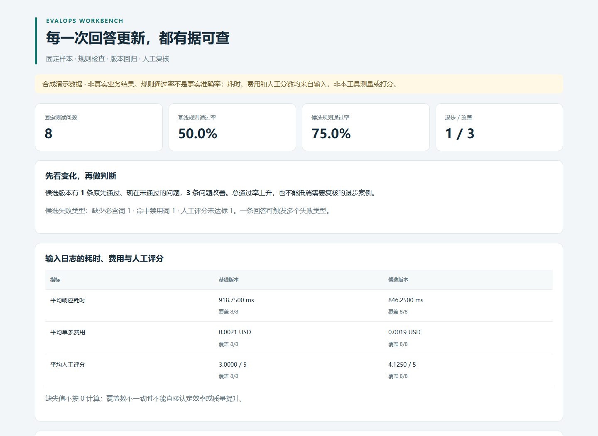

# EvalOps Workbench

**让 AI 回答的每次更新，都能追溯到具体问题。**

面向 AI 产品运营的离线评测工具：把同一批问题的两版回答放在一起，检查文本规则、定位退步案例，并导出可人工复核的报告。Python 3.11+，运行时零第三方依赖，不需要模型密钥，不上传数据。





## 为什么做这个项目

修改提示词后，整体通过率可能上升，某些原先正确的流程却退步。本项目将“逐条回归”作为运营检查重点，帮助维护测试集、整理失败类型、安排人工复核。

这是独立实现的轻量工具，参考 [promptfoo](https://github.com/promptfoo/promptfoo) 的规则评测与 [Langfuse](https://github.com/langfuse/langfuse) 的持续评估思路，不是它们的分支，也没有复制其源码。项目由 AI 辅助开发；功能边界和验证方式公开记录。

## 五分钟运行

```bash
git clone https://github.com/LeiQingliang/evalops-workbench.git
cd evalops-workbench
python -m evalops demo
```

用浏览器打开 `artifacts/demo/report.html`。同时生成 `report.json` 和 `case-results.csv`。命令不调用外部服务，三个文件都可离线查看。

内置 8 条**合成客服问题及预录回答**，包括空回答、错误承诺、规则退步和人工评分未达标。演示中的规则通过数为 4/8 → 6/8，同时存在 1 条退步、3 条改善。这些数字是固定测试数据的结果，不是真实用户效果、模型能力或业务业绩。

## 功能

| 工作 | 当前实现 |
| --- | --- |
| 固定评测集 | CSV / JSONL 导入，按唯一 `id` 对齐两版回答 |
| 文本规则 | 非空、所有必含词、任意禁用词；忽略字母大小写 |
| 人工评分 | 导入 0–5 分，可按样本配置最低分；不自动打分 |
| 版本变化 | 逐条识别改善、退步、持续通过、持续失败 |
| 日志指标 | 展示输入的耗时、费用、人工分数及其覆盖数 |
| 运营交付 | 独立 HTML 报告、完整 JSON、便于复核的 CSV |
| promptfoo | 导出测试集 JSON 和 YAML 配置模板；不执行模型 |

**规则通过率不等于事实准确率。** 关键词出现在否定句或错误语境中仍可能通过；参考答案只供人工对照，不参与自动语义判断。本项目不做检索质量评估、LLM 裁判、统计显著性检验或在线实验。

## 使用自己的数据

```bash
python -m evalops run --cases my-cases.csv --baseline baseline.csv --candidate candidate.csv --output artifacts/my-review
```

每份文件可以独立选择 `.csv` 或 `.jsonl`。UTF-8 / UTF-8 BOM 均可。CSV 必须有表头；JSONL 每行一个对象。

**问题表**（可从 `evalops/data/cases.csv` 复制）：

| 字段 | 含义 |
| --- | --- |
| `id` | 必填、非空、唯一的字符串；去除首尾空格后对齐 |
| `question` | 必填的问题文本 |
| `reference_answer` | 可选，供人工参考 |
| `required_terms` | 可选，所有词都必须出现；CSV 以 `|` 分隔，JSONL 可用字符串数组 |
| `forbidden_terms` | 可选，任一词出现即失败；格式同上 |
| `human_min_score` | 可选，0–5；填写后对应回答必须有人工分数 |
| `category` | 可选，运营分类标签 |

**回答表**（两版格式相同）：

| 字段 | 含义 |
| --- | --- |
| `id` | 必填，必须与问题表完全一致 |
| `response` | 必须有该字段；允许空字符串，计为失败 |
| `latency_ms` | 可选，非负有限数，输入日志的耗时，单位毫秒 |
| `cost_usd` | 可选，非负有限数，输入日志的费用，单位美元 |
| `human_score` | 可选，0–5 的人工分数 |

缺失或多余回答行、重复 ID、非法数值和缺少必要字段会报错退出，**不会静默删除样本改变分母**。可选指标为空时按“缺失”处理，不补零。均值分母为提供了该指标的回答数；报告同时显示覆盖数。建议两版使用相同的人评标准、样本和测量方法。

CSV 导出针对以 `= + - @` 开头的文本添加单引号，减少在电子表格中被当作公式的风险；JSON 保留原文。导出的报告含输入内容，应按原始数据的保密要求保存。

## 用回归结果控制退出码

```bash
python -m evalops run --cases evalops/data/cases.csv --baseline evalops/data/baseline.csv --candidate evalops/data/candidate.csv --fail-on-regression
```

- `0`：运行成功；未启用门禁时不因规则失败退出。
- `1`：启用 `--fail-on-regression` 且至少一条原先通过的样本退步。报告仍生成。
- `2`：参数或输入错误，未开始有效评测。

演示数据刻意包含退步，以上命令返回 `1` 是预期行为。门禁仅反映所配置规则，不代表上线审批。

## 导出到 promptfoo

```bash
python -m evalops export-promptfoo --cases evalops/data/cases.csv --provider "ollama:chat:my-model" --output artifacts/promptfoo
```

`my-model` 是占位名称，需替换成你实际配置的 provider。输出 `tests.json` 和 `promptfooconfig.yaml`。配置默认只把问题作为提示词，你应添加实际产品提示词后，在已安装并配置好 promptfoo 的环境自行执行：

```bash
promptfoo eval --config artifacts/promptfoo/promptfooconfig.yaml
```

导出包括非空断言、`icontains` 和 `not-icontains`。人工最低分只写入 metadata，**未导出成自动评分规则**。本项目测试覆盖导出结构，不包含 promptfoo 运行、模型调用或与 Langfuse 的在线联调；模型调用是否计费由你使用的服务决定。

格式依据：[测试集 JSON 与文件引用](https://www.promptfoo.dev/docs/configuration/parameters/)、[确定性断言与 `not-` 前缀](https://www.promptfoo.dev/docs/configuration/expected-outputs/deterministic/)。Langfuse 的对接字段建议见 [运营方法](docs/运营方法.md)，当前仅是映射说明。

## 验证与目录

```bash
python -m unittest discover -s tests -v
```

测试覆盖固定集分母、缺样本、重复 ID、空回答、人工分数边界、缺失指标、输入校验、HTML 转义、CSV 公式保护、回归退出码及导出结构。GitHub Actions 对 Python 3.11 / 3.12 运行相同测试和演示命令。

```text
evalops/       输入校验、规则评测、报告、命令行
evalops/data/  公开的合成样本与两版回答
tests/         标准库 unittest 测试
docs/          运营方法与演示报告
artifacts/     本地生成文件，已忽略
```

默认不需要安装。需要命令行入口 `evalops` 时可自行执行 `pip install .`；构建依赖 setuptools，运行时依赖仍为空。

## 许可

[MIT](LICENSE)。原始代码与演示数据随本项目发布。上游项目名称和链接仅用于说明参考关系，不代表合作或官方认可。

## 配套实践项目

- [supportops-studio](https://github.com/LeiQingliang/supportops-studio)
- [growthops-lab](https://github.com/LeiQingliang/growthops-lab)
